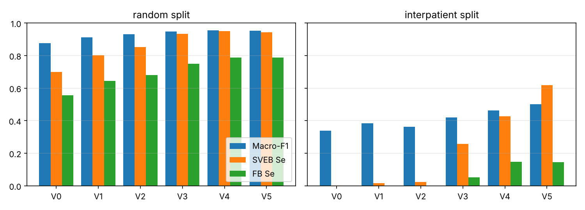

# ECG Signal Classification on MIT-BIH: from 97.6% to 99.4%

Improves the pipeline of the original repo
([MinhTime/ECG-Signal-Classification](https://github.com/MinhTime/ECG-Signal-Classification)),
which reimplements Subba & Chingtham, *IEEE Access* 2024 (wavelet denoising + handcrafted features +
Random Forest, 5 AAMI classes N / SVEB / VEB / FB / Q).

Each version changes **exactly one factor** vs the previous one. Each notebook says why at the top
(what went wrong in the previous result, the theory behind the fix, and the paper it comes from).

| Version | One change | Why |
|---|---|---|
| V0 | baseline (original pipeline) | reproduction |
| V1 | + RR-interval features | SVEB is a *premature* beat: timing, not shape (de Chazal 2004) |
| V2 | + time-domain morphology | FFT magnitude loses QRS position/width (Mondejar-Guerra 2019) |
| V3 | Random Forest -> LightGBM | boosting fixes the remaining hard cases (Ke 2017) |
| V4 | up-sampling -> SMOTE | FB copied 31x overfits; SMOTE makes new samples (Chawla 2002) |
| V5 | + patient-normalised RR | RR relative to each person's heart rate (Lin & Yang 2014) |

## Results (Kaggle CPU runs, seed 42, values in %)

**Main metric is macro-F1**: accuracy is dominated by the N class (83% of beats).
`random` = the paper's protocol (stratified 80/20 split of beats).
`interpatient` = honest check, train on DS1 patients, test on unseen DS2 patients (de Chazal 2004).

**random split**

| Version | Change | Acc | Macro-F1 | SVEB Se | FB Se | VEB Se |
|---|---|---|---|---|---|---|
| V0 | baseline: paper features + RF + up-sampling to 20k | 97.57 | 87.60 | 69.96 | 55.62 | 90.53 |
| V1 | + RR-interval features (pre, post, local mean, ratio) | 98.47 | 91.23 | 80.22 | 64.38 | 94.61 |
| V2 | + time-domain morphology (beat waveform pooled to 72 points) | 99.01 | 93.10 | 85.25 | 68.12 | 96.68 |
| V3 | classifier RF -> LightGBM (gradient boosting) | 99.36 | 94.85 | 93.35 | 75.00 | 98.41 |
| V4 | balancing: random up-sampling -> SMOTE | 99.42 | 95.42 | 95.14 | 78.75 | 98.41 |
| V5 | + patient-normalised RR (RR / record mean RR) | 99.39 | 95.31 | 94.42 | 78.75 | 98.48 |

**interpatient split**

| Version | Change | Acc | Macro-F1 | SVEB Se | FB Se | VEB Se |
|---|---|---|---|---|---|---|
| V0 | baseline: paper features + RF + up-sampling to 20k | 90.88 | 33.75 | 0.22 | 0.00 | 84.50 |
| V1 | + RR-interval features (pre, post, local mean, ratio) | 94.44 | 38.35 | 1.63 | 0.00 | 92.17 |
| V2 | + time-domain morphology (beat waveform pooled to 72 points) | 92.66 | 36.23 | 2.29 | 0.00 | 91.30 |
| V3 | classifier RF -> LightGBM (gradient boosting) | 90.43 | 42.00 | 25.64 | 5.15 | 96.52 |
| V4 | balancing: random up-sampling -> SMOTE | 90.70 | 46.27 | 42.79 | 14.69 | 95.96 |
| V5 | + patient-normalised RR (RR / record mean RR) | 92.29 | 50.15 | 61.89 | 14.43 | 95.84 |



Key points
- Paper protocol: accuracy 97.57 -> 99.42, macro-F1 87.60 -> 95.42, SVEB Se 70.0 -> 95.1, FB Se 55.6 -> 78.8 (V4).
- The random split puts beats of the same patient in train and test, so it is optimistic. On unseen
  patients the original pipeline finds almost no SVEB (Se 0.2%); V5 reaches 61.9% (macro-F1 33.8 -> 50.2).
- V5 does not help the random split but is the biggest step on new patients.

## Layout

```
src/            pipeline (dataset, preprocess, features, models, metrics, run, config = versions)
notebooks/      one Kaggle notebook per version (v0..v5) + build_notebooks.py that generates them
results/<V>/    metrics.json + report.txt per split, kaggle.log; summary.md / summary.csv
figures/        results.png + make_figures.py
automation/     kaggle_run.py: push notebooks to Kaggle and collect outputs
paper/          ECG_Paper_v2.docx (report + new Section IX with these experiments) + make_paper_v2.py
```

## Run

```bash
pip install -r requirements.txt
# MIT-BIH WFDB files: https://physionet.org/content/mitdb/1.0.0/  (or Kaggle dataset
# abdallahwagih/mit-bih-arrhythmia-database)
python -m src.run --versions V0 V1 V2 V3 V4 V5 --split random interpatient --data-dir ./mitdb --out results
python figures/make_figures.py
```

Full run of all versions takes about 15 minutes on 4 CPU cores. No GPU needed.

On Kaggle:

```bash
export KAGGLE_USERNAME=... KAGGLE_KEY=...
python notebooks/build_notebooks.py
python automation/kaggle_run.py push V5      # then: status V5 / collect V5
```

## Add a new version

Add an entry to `VERSIONS` in `src/config.py` (one change vs `based_on`), add its "why" text to
`WHY` in `notebooks/build_notebooks.py`, rebuild the notebooks and push.
